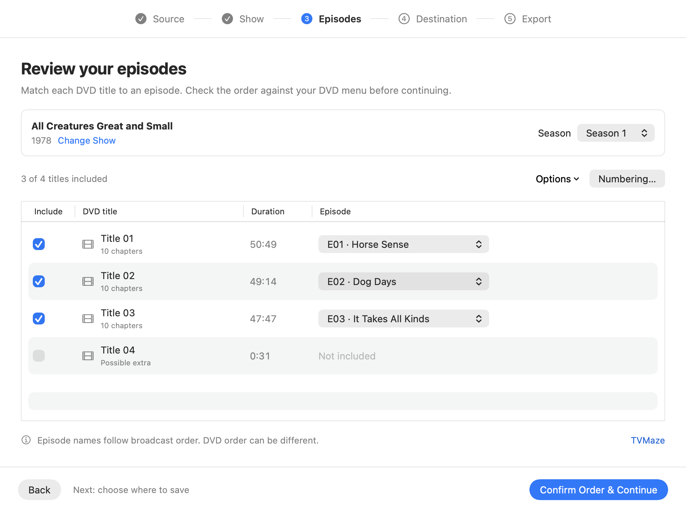

# DiscShift

**Your DVDs. Your TV library.**

A guided Mac app that turns TV DVDs into smaller video files, named and organized for Jellyfin.

Find your show, check the episode order, and choose where to save. DiscShift uses Apple hardware encoding to create MP4, M4V, MOV, or MKV files and puts them into the right show and season folders.

[Download for Mac](https://github.com/iOSDeveloperGuy/DiscShift/releases) · [Get started](#first-run-setup) · [Report an issue](https://github.com/iOSDeveloperGuy/DiscShift/issues)

Apple Silicon · macOS 14 or later · Signed and notarized · Development preview



Match each title to the right episode before exporting. Online episode names are suggestions; you confirm the DVD order.

## Download

Download the ZIP from [Releases](https://github.com/iOSDeveloperGuy/DiscShift/releases), extract it, and open DiscShift. It installs itself in Applications, then helps you get your Mac ready. Future updates are available inside the app.

Public releases are signed with Developer ID, notarized by Apple, and include a stapled ticket. This is an Apple Silicon development preview for macOS 14 and later; see [validation and current limits](#validation-and-current-limits) before exporting a collection.

<details>
<summary>Installation details</summary>

If the shared Applications folder isn’t writable, DiscShift uses Applications in your home folder. You can also move the app there yourself before opening it.

After the installed copy opens successfully, DiscShift moves matching app copies from Downloads to Trash, including Safari downloads opened from a protected temporary location. ZIP archives and other versions are kept. Cleanup leaves macOS quarantine intact; if folder access is denied, the app remains usable and the download can be removed in Finder.

</details>

## First-run setup

The setup assistant checks your Mac before you start:

1. **Check My Mac** finds an existing HandBrakeCLI reader, runs its version check, and checks that it advertises Apple hardware encoding.
2. If the reader is missing or unusable, **Install DVD Reader** uses an existing [Homebrew](https://brew.sh) installation to install the `handbrake` formula. If Homebrew is absent, setup links to the [official HandBrakeCLI download](https://handbrake.fr/downloads2.php) and lets you choose the downloaded executable. The graphical HandBrake app alone is not the command-line reader.
3. Reader installation includes its required components, which on the current Homebrew package also bring in DVD support. Setup shows **DVD support is included** when it is detected. A separate **Add DVD Support** option appears only after the reader passes its check and that support is still missing. Video files and unprotected DVDs can work without it. Library presence does not guarantee disc compatibility; the first real scan checks that.
4. Review the online show-lookup preference, then start using DiscShift.

Installations require an explicit button click. DiscShift does not bootstrap Homebrew or request an administrator password; it invokes your existing Homebrew executable directly. Installation details and retry controls stay available if something fails. Cancel stops the installation processes; components already installed remain on the Mac. Setup completion is saved only after the reader check passes. You can choose **Set Up Later** and reopen setup from **Help → Set Up DiscShift…** or Settings.

HandBrakeCLI and libdvdcss are separate software with their own licenses; neither is included in this repository or the app download. Technical names, reader versions, custom locations, and installation logs stay in **Advanced** and **Details**. Settings also keeps custom reader and DVD-support locations inside **Advanced**. The tools and libraries must match your Mac's architecture.

## From disc to library

1. **Source** — use a detected DVD or choose a VIDEO_TS folder, disc image, or video file. Scan to find its titles.
2. **Show** — search using a cleaned disc name, choose the correct show/version, or enter details manually offline.
3. **Episodes** — review the included titles, durations, season, and episode assignments together. Match them against your DVD menu, then choose **Confirm Order & Continue**.
4. **Destination** — choose the TV library folder Jellyfin scans. Preview the show folder, season folder, and filenames.
5. **Export** — choose MP4, M4V, MOV, or MKV; choose HEVC or H.264; review estimated sizes and subtitle handling; then export.

The app starts with real source state and blank show details. Changing the source clears stale metadata. **Next Disc** preserves the chosen show for the following disc and starts numbering after the highest completed episode. Each disc requires its own episode-order confirmation; changing assignments invalidates that confirmation. Duplicate episode numbers are blocked.

A completed output looks like:

```text
Series Title/
  Season 01/
    Series Title S01E01.mp4
```

An optional release year is included in the show folder. DiscShift does not contact Jellyfin directly; its library watcher or a manual library scan imports completed files.

## Encoding and file types

- **MP4 + HEVC** is the default. HEVC and H.264 use Apple VideoToolbox hardware encoding. DiscShift checks advertised encoder support and requires an actual matching Apple encoder identifier during each export before publishing the file. It stops if hardware encoding cannot be confirmed.
- **M4V** uses the MP4 container with Apple's video extension. **MOV** uses the QuickTime container. **MKV** supports the broadest range of original tracks. Selecting a container does not change the video bitrate.
- **Smaller files**, **Balanced**, and **Higher quality** use average video bitrate. DVD HEVC targets are 700, 1000, and 1800 kbps; H.264 uses 1.8 times those budgets. Larger sources and bob motion use higher budgets. Resolution is not increased.
- Estimates include scanned audio tracks and container overhead. A 50-minute DVD episode with one 192 kbps audio track is estimated at roughly 341 MB, 456 MB, or 762 MB with HEVC. Actual size and visible quality vary by content.
- Hardware decoding is requested where supported. Disc reading, unsupported decoders, motion filtering, audio, and file operations can still use the CPU.
- All audio tracks are requested. Apple containers retain supported audio codecs and convert unsupported tracks to AAC; MKV permits broader passthrough.
- Text subtitles and chapter data are requested. Picture subtitles cannot remain selectable in MP4/M4V/MOV. When affected tracks are found, you must choose MKV or explicitly approve leaving those tracks out. Subtitles are never burned into the picture automatically. Text-subtitle styling may be simplified during conversion.
- Adaptive decomb is the default. Smooth motion uses bob decomb; Off disables it. Source timing and anamorphic DVD geometry are retained, with no crop.

HandBrake re-encodes video; DiscShift has no lossless extraction mode. Existing exports are not automatically converted. Test representative content before exporting a collection.

Exports run sequentially. Incomplete files are kept in `.discshift-staging` under your destination, then moved into the season folder after successful encoding and hardware confirmation. **Existing final files are never overwritten.** Cancel removes the current incomplete output and preserves completed episodes. A failure stops subsequent jobs. A force quit or power loss can leave staging files behind; these can be removed when no export is running. Jobs are not persistent or resumable.

## Show metadata and privacy

Show search and episode lists come from the free [TVMaze API](https://www.tvmaze.com/api). No account or API key is required. Only the cleaned disc name, search text, and chosen public show ID are sent. Videos, audio, local paths, and library contents are not uploaded. Automatic lookup can be disabled; manual entry works offline. The system URL cache may cache public API responses.

A DVD usually supplies durations and chapters, but cannot reliably establish show identity or episode order. The disc label is a search hint. TVMaze supplies broadcast order, which may differ from DVD order. Disc numbers are never interpreted as season or episode numbers. You confirm every mapping before export. Unnumbered specials require manual numbering, including season 0 where appropriate. DiscShift does not split a title containing multiple episodes.

TVMaze metadata is available under [CC BY-SA](https://creativecommons.org/licenses/by-sa/4.0/), separately from DiscShift's source license. The app credits TVMaze and links to the selected show.

## Build from source

DiscShift is built with SwiftUI and uses Sparkle for signed in-app updates. Its app identifier is `com.iosdeveloperguy.discshift`. On first launch it can import recognized settings from one matching app in the same publisher namespace, preserving setup and library preferences. Existing settings take priority.

Install full Xcode, open `Package.swift`, and run DiscShift on My Mac. To build a standalone app:

```sh
bash scripts/build-app.sh
```

The script runs tests, builds Release, creates the icon's macOS sizes, enables hardened runtime, signs the app, verifies its signature, and creates `dist/DiscShift.app.zip`. Local builds use an ad hoc signature by default. Set `DISCSHIFT_SIGNING_IDENTITY` to use an installed Developer ID Application certificate. It selects the installed Xcode developer tools for this run without changing the system-wide setting. Builds use a temporary directory to avoid iCloud/File Provider metadata affecting signatures; set `DISCSHIFT_BUILD_DIR` to override it. Prefer the ZIP when moving the app out of Documents.

For a public signed release, [the release guide](docs/RELEASING.md) explains the required Apple account setup. `scripts/notarize-with-xcode.sh` uses the account already signed into Xcode and produces a notarized ZIP after ticket and Gatekeeper checks. A separate `scripts/notarize-release.sh` supports notarytool Keychain credentials and also packages a notarized drag-to-Applications DMG.

To run the normal tests separately:

```sh
DEVELOPER_DIR=/Applications/Xcode.app/Contents/Developer \
swift test --scratch-path /tmp/discshift-tests
```

Normal tests use isolated fixtures and do not install software or read mounted discs. Live tests are opt-in:

```sh
DISCSHIFT_TEST_METADATA=1 bash scripts/build-app.sh
```

```sh
DISCSHIFT_TEST_SOURCE=/absolute/path/to/test-source.mkv \
DISCSHIFT_TEST_OUTPUT=/absolute/path/to/new-test-output.mp4 \
DEVELOPER_DIR=/Applications/Xcode.app/Contents/Developer \
swift test --scratch-path /tmp/discshift-reader-tests --filter ReaderIntegrationTests
```

The reader test scans the chosen source, encodes six seconds, and requires an actual hardware encoder identifier. Choose a new output path; existing files are rejected. Optional variables: `DISCSHIFT_TEST_READER`, `DISCSHIFT_TEST_CONTAINER` (`mp4`, `m4v`, `mov`, `mkv`), and `DISCSHIFT_TEST_ENCODER` (`hevc`, `h264`).

## Validation and current limits

Version 0.9.2 passes 67 automated tests; two live tests are opt-in and skipped in normal runs. See [VALIDATION.md](VALIDATION.md) for observed results and remaining checks, and [1.0 readiness](docs/1.0-READINESS.md) for the release gates. The current setup checks were exercised with an installed HandBrakeCLI on Apple Silicon. Installation success, failure, and cancellation are tested with isolated simulated installers; a fresh dependency installation on a clean Mac has not been validated.

Prior tests verified short physical-DVD hardware encodes, all four output containers, native decoding of Apple-container files, multiple audio tracks, text subtitles, and chapter data. A full physical episode, long-term audio sync, actual Jellyfin clients, Intel builds, and macOS 14 have not been validated. The app is currently distributed as a development preview.

Other limits include no automatic verification of DVD title identity, combined-title splitting, movie workflow, persistent jobs, or automatic export retry. Reader paths, destination, encoding preferences, lookup preference, and optional ejection preference persist. The app is not sandboxed and needs access to selected local tools and media locations.

## License and credits

DiscShift source and app artwork are [MIT licensed](LICENSE). The app icon was created using image generation; [artwork source notes](Assets/README.md) include the prompt. HandBrake and libdvdcss are external projects with separate licenses and are not redistributed here.

- [HandBrake CLI documentation](https://handbrake.fr/docs/en/latest/cli/command-line-reference.html)
- [Apple VideoToolbox in HandBrake](https://handbrake.fr/docs/en/latest/technical/video-videotoolbox.html)
- [HandBrake container support](https://handbrake.fr/docs/en/latest/technical/containers.html)
- [HandBrake subtitle support](https://handbrake.fr/docs/en/latest/advanced/subtitles.html)
- [libdvdcss](https://www.videolan.org/developers/libdvdcss.html)

## Automatic updates

Starting with 0.9.0, use **DiscShift → Check for Updates…**, or enable automatic checks and background downloads in Settings. People on 0.8.2 install this next release once; future updates happen in the app. Updates wait for disc operations and setup to finish. See [automatic updates and push-to-release setup](docs/AUTOMATIC-UPDATES.md) for the publishing workflow and required encrypted credentials.
